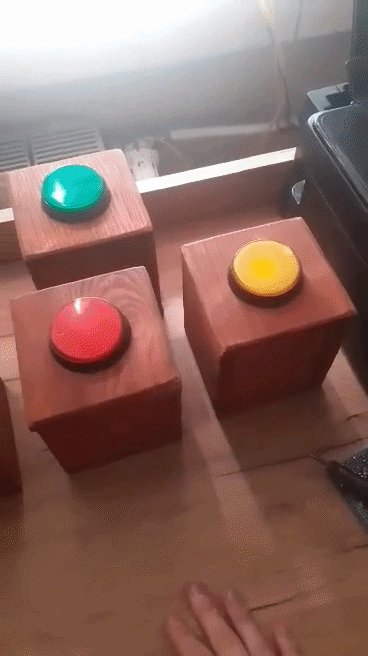
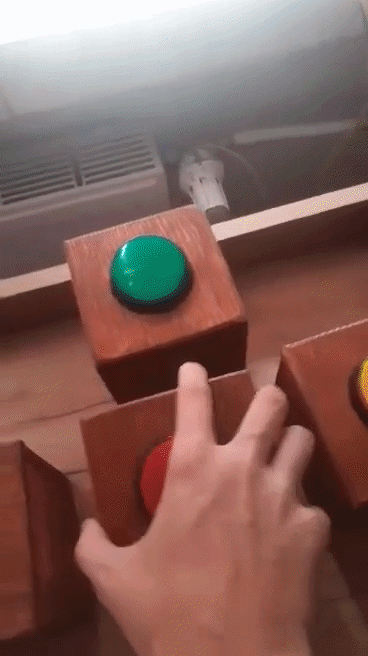

## Bezprzewodowe Guziki Do Familiady

Hardware'owy system przycisków turniejowych (w stylu "Familiady") zbudowany w oparciu o mikrokontrolery Arduino i komunikację radiową 2.4 GHz. System bezbłędnie rozstrzyga, który z graczy zgłosił się jako pierwszy, blokując pozostałe przyciski.

## Wykorzystany Hardware

System składa się z jednostki centralnej (Bazy) oraz bezprzewodowych przycisków graczy (Node'ów). Do budowy każdego z nich użyto:
* **Mikrokontroler:** Arduino Nano (ATmega328P)
* **Komunikacja:** Moduł radiowy nRF24L01 (komunikacja po magistrali SPI)
* **Zasilanie:** Pakiet 2x18650 (mobilność i długi czas działania)

## Logika działania i wyzwania techniczne

Kluczowym problemem w tego typu systemach jest opóźnienie oraz jednoczesne wciśnięcie przycisków. Zostało to rozwiązane poprzez:
1. **Architekturę Master-Slave:** Baza centralna cyklicznie nasłuchuje przerwań, co eliminuje kolizje pakietów radiowych.
2. **Debouncing sprzętowy/programowy:** Zabezpieczenie przed "drganiem styków" mechanicznych przycisków, aby jedno uderzenie nie było rejestrowane jako seria kliknięć.

## Galeria (Wnętrze i elektronika)

## 🚀 Jak uruchomić kod
W repozytorium znajdują się dwa pliki źródłowe:
* `baza.ino` - kod wgrywany do centralnego Arduino.
* `przycisk.ino` - kod wgrywany do każdego z przycisków (z odpowiednią zmianą adresu w kodzie).

Wymagane biblioteki (dostępne w Menedżerze Bibliotek Arduino IDE):
* `RF24` (autor: TMRh20)
* `SPI` (wbudowana)
